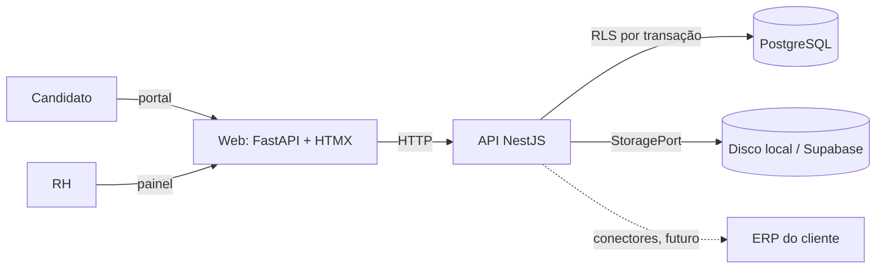

# KRONOS — ATS + Admissão

ATS em que **cada candidato é um chamado** com protocolo único (ex.: `ADM-2026-000123`), da candidatura até a admissão concluída na folha, integrado ao ERP do cliente (Fortes, Domínio, Alterdata, Totvs, Senior…) por **conectores**.

> Projeto de demonstração do curso de IA generativa. Não tem comprador e usa apenas serviços gratuitos ou locais. Todos os dados são fictícios.

**Demo em 3 minutos:** [`docs/DEMO.md`](docs/DEMO.md) traz o roteiro de vídeo e o texto de divulgação.

---

## A ideia

### O problema
O recrutamento acontece num lugar (Gupy, planilha, e-mail) e a admissão em outro (WhatsApp para pedir documentos, digitação manual na folha). O RH digita tudo duas vezes, perde documentos e não sabe em que etapa cada pessoa está.

### A solução
1. **Candidato**: se candidata, acompanha o chamado e envia documentos pelo celular.
2. **RH**: trabalha numa fila de chamados com status, responsável e prazo (SLA), e aprova ou recusa cada documento com um motivo.
3. **Admissão**: aprovado o candidato, os dados já validados seguem para o ERP do cliente, sem redigitar nada.

O chamado passa por 10 status, de *Triagem* a *Admitido*, com dois retornos: documento recusado volta ao candidato com o motivo, e erro no ERP volta à fila do DP. Mais detalhes em [`docs/RESUMO.md`](docs/RESUMO.md).

---

## O que já existe

| Área | Entrega | Situação |
|---|---|---|
| Domínio | Agregado `Chamado` com máquina de estados, `Cpf`, `Admissao` (subconjunto do S-2200 do eSocial), protocolo sequencial | Pronto, com testes |
| Banco | PostgreSQL com **Row Level Security** por empresa, filial e pessoa atribuída; trilha `ticket_events` só de inserção | Pronto, com testes contra Postgres real |
| API de chamados | Abrir (`POST /chamados`), consultar (`GET /chamados/:protocolo`) e transicionar (`POST /chamados/:id/transicoes`) | Pronto |
| API de documentos | Enviar, listar com checklist, baixar e aprovar/recusar; tipo conferido pelo **conteúdo** do arquivo (JPG, PNG, PDF, até 5 MB) | Pronto |
| Contrato | OpenAPI 3.1 gerado dos mesmos schemas Zod que validam a entrada (`GET /openapi.json`) | Pronto |
| Portal do candidato | Vagas, candidatura com validação de CPF e consentimento LGPD, envio de documentos, acompanhamento | Pronto (modo demo) |
| Painel do RH | Fila com busca, filtro e SLA; detalhe com linha do tempo; aprovar/recusar documento sem recarregar a página | Pronto (modo demo) |
| Segurança | Cabeçalhos (CSP, nosniff), rate limit, validação estrita na borda, token assinado, varredura de segredos no CI | Pronto; login com 2FA ainda não |
| Próximos | Exportar arquivo para o ERP (Fortes ou Totvs), trava de envio sem documentos aprovados, anonimização LGPD, conectores | [Issues abertas](../../issues) |

O front ainda lê dados fictícios em memória (modo demo); ligar o painel à API é o próximo passo da issue da fila do RH.

---

## Como foi feito

- **Em passos pequenos.** Cada entrega virou um pull request revisado (dezenas até aqui), seguindo os marcos em [`docs/milestones/`](docs/milestones) e o checklist de [`docs/PASSOS.md`](docs/PASSOS.md).
- **Decisões registradas.** O que não era código virou issue de decisão (ERP dos primeiros clientes, campos do S-2200, ASO) e as escolhas de arquitetura estão em [`docs/adr/`](docs/adr).
- **Domínio primeiro.** As regras (transições, CPF, protocolo, documento) ficam em classes puras, testadas sem banco nem HTTP. O banco e a API só adaptam.
- **O banco é a última barreira.** O isolamento entre empresas e o "quem pode ver/escrever o quê" estão em políticas RLS. A API conecta com um papel sem `BYPASSRLS` e **recusa subir** se estiver com um papel que ignoraria o RLS.
- **Segurança desde o início.** Entrada validada com Zod (erros nunca devolvem o valor recebido), arquivos validados por magic bytes, nenhum URL público de documento, trilha de auditoria imutável.
- **Testado de verdade.** Testes unitários, testes HTTP + RLS contra Postgres descartável e um roteiro ponta a ponta (`npm run e2e:demo`).
- **Custo zero.** Postgres e Redis locais por Docker, armazenamento em disco atrás de uma porta (`StoragePort`) que pode virar Supabase Storage ou MinIO sem tocar no domínio.
- **Feito em parceria com o Claude Code**, que escreveu, testou e abriu os pull requests sob revisão humana.



## Stack

| Camada | Tecnologia |
|---|---|
| Front-end | Python: FastAPI + Jinja2 + HTMX |
| Back-end | NestJS (Node.js + TypeScript), Zod |
| Banco | PostgreSQL 17 + Prisma, com Row Level Security |
| Fila / cache | Redis (reservado para BullMQ; ainda não usado) |
| Testes | Vitest + Supertest (API), pytest (front) |
| CI | GitHub Actions (testes, RLS real, gitleaks) |

## Estrutura do repositório
```
apps/
  api/   API NestJS: domínio, chamados, documentos, RLS, OpenAPI
  web/   Portal e painel (FastAPI + Jinja2 + HTMX)
docs/    Escopo, arquitetura, dados, módulos, milestones e ADRs
docker-compose.yml   PostgreSQL e Redis para desenvolvimento local
```

---

## Como usar

### 1. Só ver a tela (30 segundos, sem banco)
Pré-requisito: Python 3.
```bash
cd apps/web
python -m venv .venv && .venv/Scripts/activate     # Linux/Mac: source .venv/bin/activate
pip install -r requirements.txt
uvicorn app.main:app --reload                      # http://localhost:8000
```
- **Candidato:** `/` → escolha uma vaga → candidate-se (CPF de teste `529.982.247-25`) → envie documentos em `/chamado/<protocolo>`.
- **RH:** `/painel/fila` → abra `ADM-2026-000001` → aprove ou recuse os documentos → avance o status até *Admitido*.

O modo demo (`DEMO_MODE=true`, padrão) usa dados fictícios em memória e não tem login. Fora dele, `API_BASE_URL` e `SESSION_SECRET` (32+ caracteres) são obrigatórios.

### 2. Rodar a API de ponta a ponta
Pré-requisitos: Node.js, Docker.
```bash
# Variáveis de ambiente
cp .env.example apps/api/.env
#   edite apps/api/.env: DATABASE_URL (papel kronos_api), MIGRATE_DATABASE_URL (admin),
#   e troque JWT_SECRET e ENCRYPTION_KEY por valores de 32+ caracteres.
#   Dica: use 127.0.0.1 em vez de localhost nas URLs (o Compose publica só em IPv4).

docker compose up -d                               # PostgreSQL e Redis

cd apps/api
npm install
npx prisma generate
npx prisma migrate deploy                          # usa MIGRATE_DATABASE_URL
docker compose exec -T postgres psql -U kronos -d kronos < prisma/dev/app-role.sql   # papel de login da API (só dev)
npm run start:dev                                  # http://localhost:3000
```
- `GET /health` → `{"status":"ok"}` · `GET /openapi.json` → contrato da API (guia em [`docs/API.md`](docs/API.md)).
- A API **recusa subir** se `DATABASE_URL` for de superusuário, BYPASSRLS ou dono das tabelas.
- Porta 5432 ocupada? `POSTGRES_PORT=5433 docker compose up -d` (Bash) ou `$env:POSTGRES_PORT = "5433"; docker compose up -d` (PowerShell), e ajuste as URLs.

Com a API no ar e o `.env` carregado, o roteiro ponta a ponta cria uma empresa fictícia, abre um chamado, envia e aprova um documento e confere o isolamento entre candidatos:
```bash
cd apps/api && npm run e2e:demo
```

### 3. Testes
```bash
npm test                      # na raiz: API (Vitest) + front (pytest)
cd apps/api && npm test       # só a API
cd apps/web && pytest         # só o front
```
Os testes HTTP + RLS rodam contra um Postgres **descartável**. Defina `TEST_ADMIN_DATABASE_URL` (administrador) e `TEST_APP_DATABASE_URL` (papel `kronos_api`); sem elas, são pulados. Não aponte para um banco com dados seus.

Atalhos na raiz: `npm run db:up`, `dev:api`, `dev:web`, `test`.

---

## Documentação
- Escopo completo: [`docs/escopo-produto.pdf`](docs/escopo-produto.pdf)
- Resumo em uma página: [`docs/RESUMO.md`](docs/RESUMO.md)
- Arquitetura e decisões: [`docs/ARQUITETURA.md`](docs/ARQUITETURA.md) e [`docs/adr/`](docs/adr)
- Modelo de dados: [`docs/DADOS.md`](docs/DADOS.md)
- API: [`docs/API.md`](docs/API.md)
- Módulos: [`docs/modulos/`](docs/modulos/README.md)
- Os 10 passos (checklist transversal): [`docs/PASSOS.md`](docs/PASSOS.md)
- Segurança: [`SECURITY.md`](SECURITY.md)
- Demo e roteiro de vídeo: [`docs/DEMO.md`](docs/DEMO.md)

## Fases
1. **MVP**: tenancy, chamados, vagas, portal, painel, documentos, admissão (export CSV/JSON), e-mail.
2. **Vendável**: planos/cobrança, WhatsApp, testes, assinatura digital, 1º conector ERP, relatórios.
3. **Escala**: parcerias/conectores de ERP, IA (OCR/triagem), API pública e webhooks.

## Equipe
<!-- Preencher: nomes e papéis -->

## Requisitos da disciplina
<!-- Preencher com as especificações do professor -->
