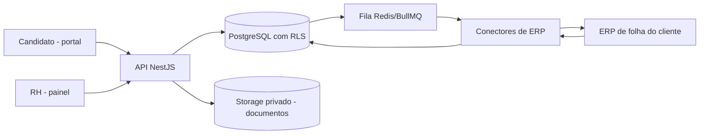
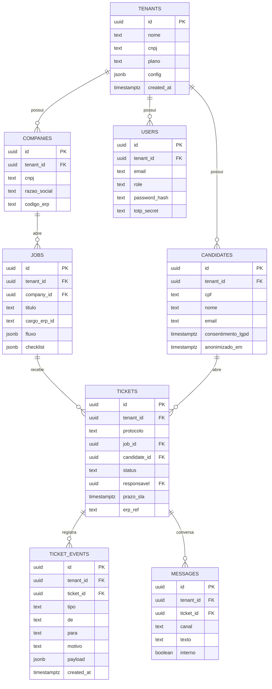

# Dados e banco — KRONOS (ATS + Admissão)

> Criado em 2026-11-04. Regras: modelo antes da primeira migration; migration revisada como mudança de produção.
> ADR de banco: [ADR-001](adr/ADR-001-banco-postgresql.md).
> Escopo de origem: [escopo-produto.pdf](escopo-produto.pdf). Este documento cobre o núcleo da Fase 1; testes, assinatura, uniforme e ERP entram na própria fase (ver "Perguntas em aberto").

## Princípios

1. `tenant_id` em **toda** tabela de negócio, primeiro campo das chaves e índices compostos; Row Level Security (`FORCE`) em todas.
2. A aplicação conecta com um papel sem `BYPASSRLS` e que não é dono das tabelas; o tenant é definido por transação (`set_config('app.tenant_id', ..., true)`).
3. `ticket_events` é **append-only** (trigger + `REVOKE UPDATE, DELETE, TRUNCATE`): correção é um evento novo.
4. Arquivos (documentos do candidato) ficam no storage privado; o banco guarda só o registro e a chave do objeto.
5. O modelo de admissão é **canônico** (campos do S-2200 do eSocial); nenhum conector de ERP altera o modelo, só o traduz.
6. Envio ao ERP é idempotente: `tickets.erp_ref` (= protocolo) é a referência externa e `erp_syncs` guarda cada tentativa.
7. Dados pessoais têm retenção: candidato não contratado é anonimizado após o prazo configurável do tenant.
8. Constraints vivem no banco (`NOT NULL`, `CHECK`, FK, `UNIQUE`); a validação na API não as substitui.

## Fluxo dos dados

## Camadas / schemas

| Schema | Guarda | Quem escreve | Quem lê | Regra |
|---|---|---|---|---|
| `public` | Modelo de negócio (tenants, chamados, vagas, candidatos) | API (papel `kronos_app`) | API | RLS por `tenant_id` |
| `public` (`admission_data`, Fase 1) | Pré-cadastro em formato canônico S-2200 | API | API, conectores | Travado para edição após `ENVIO_ERP` |
| `raw` (Fase 2) | Resposta bruta do ERP, como veio | Conectores | Conectores, suporte | Imutável; permite reprocessar sem reenviar |
| `analytics` (Fase 2+) | Visões/cópias para relatórios | Job de carga | Módulo de relatórios | Somente leitura; pode ir para DuckDB no futuro |

## Modelo — diagrama

## Chaves, constraints e índices

| Tabela | Chave natural (`UNIQUE`) | Constraints | Índices além da PK |
|---|---|---|---|
| `tenants` | — | `nome` NOT NULL | — |
| `companies` | `(tenant_id, cnpj)` | `cnpj` NOT NULL | `(tenant_id)` |
| `users` | `(tenant_id, email)` | `role IN ('ADMIN','RECRUTADOR','DP','GESTOR_VAGA','AVALIADOR','ALMOXARIFADO')` | — |
| `jobs` | — | FK `company_id` | `(tenant_id, company_id)` |
| `candidates` | `(tenant_id, cpf)` | CPF só dígitos, 11 chars | — |
| `tickets` | `(tenant_id, protocolo)` | `status IN (10 valores)`; FK `job_id`, `candidate_id` | `(tenant_id, status)`, `(job_id)`, `(candidate_id)`, parcial `(tenant_id, prazo_sla) WHERE status NOT IN ('ADMITIDO','REPROVADO')` |
| `ticket_events` | — | append-only (trigger + REVOKE) | `(ticket_id, created_at)` |
| `messages` | — | `canal IN ('EMAIL','WHATSAPP','PORTAL')` | `(ticket_id, created_at)` |

## Regras de carga e validação

| Tema | Regra |
|---|---|
| Idempotência | Candidatura repetida do mesmo CPF na mesma vaga não cria segundo chamado aberto; reenvio ao ERP usa `erp_ref` e nunca duplica o empregado |
| Dado inválido | CPF/PIS validados na API e por `CHECK` de formato no banco; candidato aprovado com qualificação cadastral divergente bloqueia o envio ao ERP |
| Datas e fuso | Instantes em `timestamptz` (UTC); datas de negócio (admissão, nascimento) em `date`, interpretadas em `America/Fortaleza` |
| Números | `numeric` para salário e tamanhos; nunca `float` |
| Protocolo | `ADM-AAAA-NNNNNN`, sequencial por tenant e ano (contador em tabela com lock de linha, não `max()+1`) |

## Volume esperado

| Tabela | Conta | Linhas em 1 ano | Linhas em 3 anos |
|---|---|---|---|
| `tickets` | 50 tenants x 40 admissões/mês x 12 x ~8 candidaturas por admissão | ~190 mil | ~580 mil |
| `ticket_events` | tickets x ~15 eventos | ~2,9 milhões | ~8,7 milhões |
| `messages` | tickets x ~6 | ~1,1 milhão | ~3,5 milhões |

Premissas a validar com o piloto; abaixo de dezenas de milhões de linhas não há particionamento (rever `ticket_events` se passar de ~30 milhões).

## Segurança, LGPD e retenção

| Item | Regra |
|---|---|
| Dado pessoal | CPF, contato, dependentes, dados bancários, ASO (saúde, dado sensível). Cliente é controlador; KRONOS é operador (DPA). Credenciais de ERP e `totp_secret` criptografados em repouso |
| Acesso (papéis) | `kronos_app` (RLS, sem BYPASSRLS, sem TRUNCATE em `ticket_events`); `kronos_migrator` só para migrations; ninguém usa o superusuário na aplicação |
| Retenção | Candidatos reprovados/desistentes: prazo configurável por tenant, depois anonimização (`anonimizado_em`); chamados admitidos seguem a guarda trabalhista definida com o jurídico |
| Backup | Diário, retenção a definir, em região Brasil. **Data do último treino de restauração: nunca realizado** (obrigatório antes do primeiro cliente pagante) |

## Migrations

| Migration | Conteúdo |
|---|---|
| `20261105000000_init` | Tabelas, uniques e índices gerados do `schema.prisma` (instantes em `timestamptz(3)`). FKs compostas `(tenant_id, id)` em jobs, tickets, ticket_events e messages: referência entre tenants é recusada pelo banco |
| `20261105000100_rls_roles` | RLS `FORCE` com política `tenant_isolation`, trigger append-only, CHECKs, índice parcial de SLA, papel `kronos_app` (sem BYPASSRLS) e `REVOKE UPDATE, DELETE, TRUNCATE` em `ticket_events` |

Teste de isolamento: `apps/api/prisma/tests/rls_isolation.sql` (rodar num banco migrado; faz ROLLBACK). `id` é gerado pelo Prisma (UUID v7 no cliente), sem default no banco. `tenants` tem RLS pela própria `id`; o `kronos_app` só faz SELECT e UPDATE nela (criar tenant é provisionamento, fora da aplicação). `kronos_migrator` e a senha do `kronos_app` ficam por ambiente, fora do repositório.

## Perguntas em aberto

- Nomes e ordem exatos dos 10 status: conferir com o diagrama do PDF (era imagem) e ajustar o `CHECK` e `ticket-status.ts` juntos.
- Tabelas ainda não modeladas: `document_types`, `documents`, `admission_data`, `erp_connections`, `erp_syncs`, `erp_lookups`, `tests*`, `signature_requests`, `contract_templates`, `uniform_*`, contador de protocolo. Entram em migrations próprias por módulo.
- Prazo de retenção da guarda de documentos admissionais (jurídico).
- Meta de RPO/RTO do backup.
